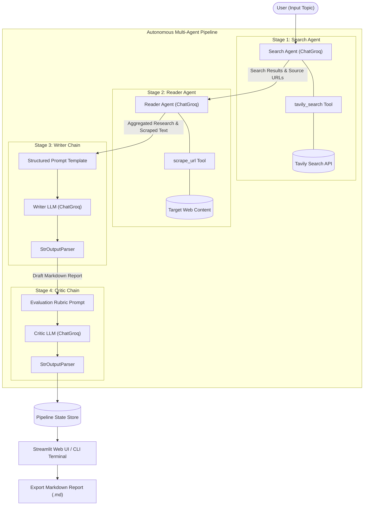

# 🔎 Multi-Agent Research System (Research Flow)

An autonomous multi-agent research and synthesis engine powered by **LangChain**, **LangGraph**, **Groq LPU Inference**, and **Tavily**. 

The system distributes end-to-end research across specialized autonomous agents and evaluators—gathering live web intelligence, scraping deep article content, synthesizing structured executive reports, and conducting strict critical reviews—all visible in real time through an interactive, modern web interface or terminal CLI.

---

## 📑 Table of Contents
- [What It Is & What It Does](#-what-it-is--what-it-does)
- [System Architecture](#-system-architecture)
  - [Workflow Diagram](#workflow-diagram)
  - [Agent & Chain Breakdown](#agent--chain-breakdown)
- [Key Features](#-key-features)
- [Tech Stack](#-tech-stack)
- [Project Directory Structure](#-project-directory-structure)
- [Getting Started](#-getting-started)
  - [Prerequisites](#prerequisites)
  - [Installation & Virtual Environment](#installation--virtual-environment)
  - [Environment Variables (.env)](#environment-variables-env)
- [Running the System](#-running-the-system)
  - [1. Streamlit Web Interface (Recommended)](#1-streamlit-web-interface-recommended)
  - [2. Command-Line Interface (CLI)](#2-command-line-interface-cli)
- [Resilience & Engineering Highlights](#-resilience--engineering-highlights)
- [Configuration & Customization](#-configuration--customization)

---

## 💡 What It Is & What It Does

Traditional single-prompt LLM research suffers from knowledge cutoffs, hallucinated facts, superficial summaries, and lack of self-correction. 

**Multi-Agent Research System** solves this by decomposing the research process into a 4-stage pipeline orchestrated by distinct LLM agents and evaluation chains:

1. **Search**: An autonomous retrieval agent queries Tavily to discover authoritative, timely sources and URLs.
2. **Deep Read**: A reader agent selects the most relevant page and extracts full, clean article body text using BeautifulSoup, bypassing scripts, ads, and navigation clutter.
3. **Synthesis & Writing**: A structured writer chain synthesizes the search briefings and scraped deep content into a cohesive, professional markdown report complete with verified source citations.
4. **Peer Review & Critique**: A critic chain rigorously evaluates the generated report against factual depth, logical structure, source credibility, and bias—awarding a numerical score (X/10) with actionable feedback.

---

## 🏗️ System Architecture

### Workflow Diagram



### Agent & Chain Breakdown

| Component | Architecture | Tool Access | Role & Responsibility |
| :--- | :--- | :--- | :--- |
| **Search Agent** | LangChain ReAct Agent (`create_agent`) | `tavily_search` | Executes multi-faceted web searches, gathers diverse perspectives, and captures canonical URLs. |
| **Reader Agent** | LangChain ReAct Agent (`create_agent`) | `scrape_url`, `tavily_search` | Inspects search results, identifies the most authoritative source, and performs deep text scraping. |
| **Writer Chain** | LangChain Expression Language (LCEL) Chain | None (pure reasoning) | Synthesizes search summaries and deep content into structured sections: Introduction, Key Findings, Conclusion, and Verified Sources. |
| **Critic Chain** | LangChain Expression Language (LCEL) Chain | None (pure evaluation) | Acts as an impartial auditor. Scores the report out of 10, itemizes strengths, lists gaps/improvements, and issues a final verdict. |

---

## ✨ Key Features

- **Autonomous Multi-Agent Collaboration**: Segregates search, deep reading, drafting, and critique across isolated agent loops.
- **Deep Web Extraction**: Cleanses raw HTML, removes DOM noise (scripts, stylesheets, navigations, footers), and extracts informative body content.
- **Interactive Web Interface (`app.py`)**:
  - **Live Step Tracker**: Visual status indicators (`Waiting`, `Working...`, `Done`, `Failed`) with animated glowing rails and execution timers.
  - **Multi-Tab Inspector**: Side-by-side tabs for the Final Report, Critic Review, Raw Search Results, and Scraped Page Text.
  - **Session History**: Preserves all research runs in a sidebar drawer for instant switching.
  - **One-Click Markdown Exports**: Download the standalone report or the full dossier (including the critic review and sources).
- **Enterprise-Grade Rate Limit Resilience**:
  - Built-in automatic backoff logic detects Groq TPM (Tokens Per Minute) and RPM limits (HTTP 429 and HTTP 413).
  - Dynamically parses Groq's wait-time response headers (`try again in Xs`) and sleeps until quotas replenish.
- **Strict Pydantic Type Contracts**: Custom `SearchInput` and `ScrapeInput` Pydantic models eliminate argument hallucinations.
- **Ultra-Fast LLM Inference**: Runs on Groq LPUs (`openai/gpt-oss-120b`, `openai/gpt-oss-20b`, or `qwen/qwen3.8-27b`) for near-instant responses.

---

## 🛠️ Tech Stack

- **Framework**: [LangChain](https://www.langchain.com/) (v1.5+) & [LangGraph](https://github.com/langchain-ai/langgraph)
- **Inference Engine**: [Groq Cloud](https://groq.com/) via `langchain-groq`
- **Web Search**: [Tavily AI Search API](https://tavily.com/)
- **Web Scraping**: `requests`, `BeautifulSoup4` (`bs4`), `lxml`, `html5lib`
- **Frontend**: [Streamlit](https://streamlit.io/)
- **Validation & Typing**: [Pydantic v2](https://docs.pydantic.dev/)

---

## 📁 Project Directory Structure

```text
Multi Agent Research System/
├── .env                       # API keys and environment configurations (ignored by git)
├── .gitignore                  # Git ignore rules
├── .streamlit/
│   └── config.toml            # Streamlit server & UI configuration
├── .vscode/
│   └── settings.json          # Workspace Python interpreter settings
├── agents.py                  # Agent builders (Search, Reader) and LCEL chains (Writer, Critic)
├── app.py                     # Streamlit frontend with live tracker and dark UI
├── pipeline.py                # Standalone pipeline script with auto-environment detection
├── requirements.txt           # Project dependencies
└── tools.py                   # Type-safe tools (tavily_search, scrape_url)
```

---

## 🚀 Getting Started

### Prerequisites

- Python **3.11+** installed
- A **Groq API Key** ([Get one at console.groq.com](https://console.groq.com/keys))
- A **Tavily API Key** ([Get one at tavily.com](https://app.tavily.com/))

### Installation & Virtual Environment

1. **Clone or navigate to the project directory:**
   ```powershell
   cd "d:\Ai Engineering\Multi Agent Research System"
   ```

2. **Create and activate a virtual environment:**
   ```powershell
   # Windows (PowerShell)
   python -m venv .venv
   .\.venv\Scripts\Activate.ps1
   ```

3. **Install dependencies:**
   ```powershell
   pip install -r requirements.txt
   ```

### Environment Variables (.env)

Create a `.env` file in the project root with the following configuration:

```env
# Tavily Search API Key
TAVILY_API_KEY=tvly-your_tavily_key_here

# Groq Cloud API Key
GROQ_API_KEY=gsk_your_groq_key_here

# Selected Groq Model (e.g. openai/gpt-oss-120b or openai/gpt-oss-20b)
GROQ_MODEL=openai/gpt-oss-120b
```

---

## 🖥️ Running the System

### 1. Streamlit Web Interface (Recommended)

To launch the full graphical research desk:

```powershell
streamlit run app.py
```

- Open `http://localhost:8501` in your browser.
- Type any topic (e.g., *"Quantum Computing in Drug Discovery"*, *"Future of Solid-State Batteries"*).
- Watch live stage timers and step progress.
- Review tabs and export your report as `.md`.

### 2. Command-Line Interface (CLI)

To run directly in your terminal:

```powershell
python pipeline.py
```

The CLI script automatically routes through the virtual environment, prompts you for a topic, and prints color-coded progress for each stage directly to standard output.

---

## 🛡️ Resilience & Engineering Highlights

- **Auto-Switching Interpreter**: `pipeline.py` detects if it is executed under a global Python installation and automatically re-executes itself within `.venv` where `langchain >= 1.0` is installed.
- **Groq Token-per-Minute (TPM) Guard**: Groq's on-demand free tier imposes an 8,000 TPM limit. The built-in `invoke_with_retry` function captures status codes `413` and `429`, parses the exact reset countdown via regex, and resumes execution seamlessly without crashing the run.
- **Isolated Import Execution**: Web scraping and network calls in `tools.py` are guarded under `if __name__ == "__main__":`, preventing accidental requests upon importing modules.

---

## ⚙️ Configuration & Customization

- **Adjust Model**: Change `GROQ_MODEL` in `.env` or in `agents.py` to test different available models:
  - `openai/gpt-oss-120b` — Best overall reasoning and synthesis depth.
  - `openai/gpt-oss-20b` — Lightweight, ultra-fast responses with low token consumption.
  - `qwen/qwen3.8-27b` — High multilingual proficiency.
- **Search Results Limit**: Modify `max_results` in `tools.py` (`tavily_search`) to pull more or fewer sources (default: `3` to `5`).
- **Scrape Depth**: Modify `[:1800]` in `tools.py` (`scrape_url`) to adjust how many characters of article body text are forwarded to the writer chain.
- **Critic Strictness**: Adjust prompt guidelines in `agents.py` (`critic_prompt`) to focus on academic rigor, executive brevity, or technical accuracy.
